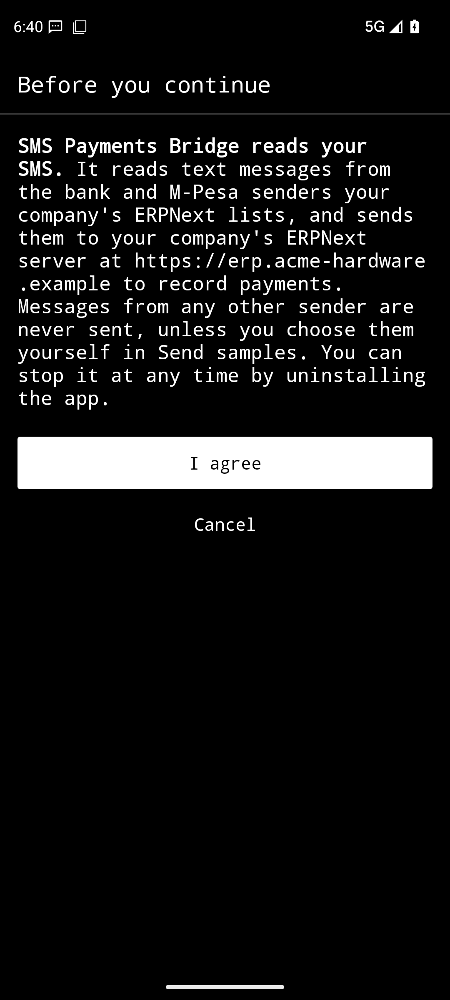
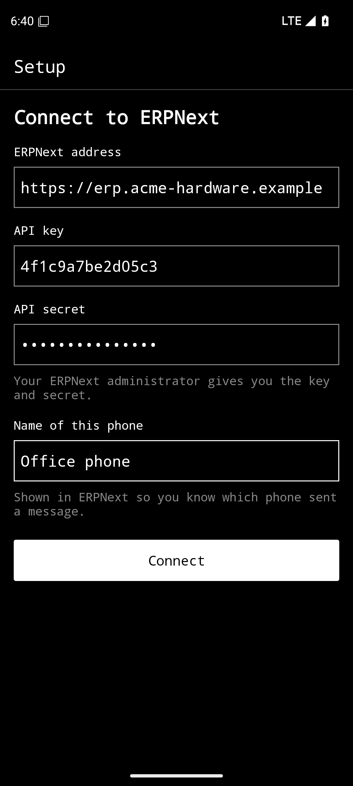
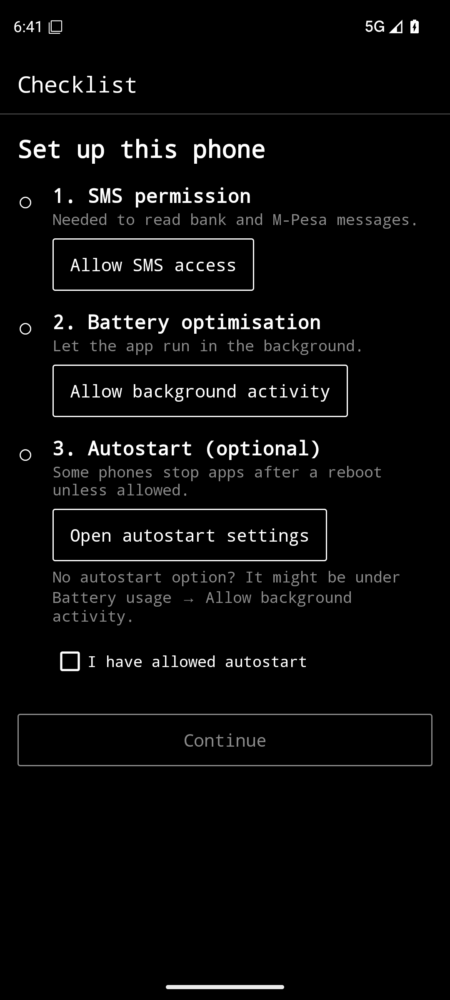
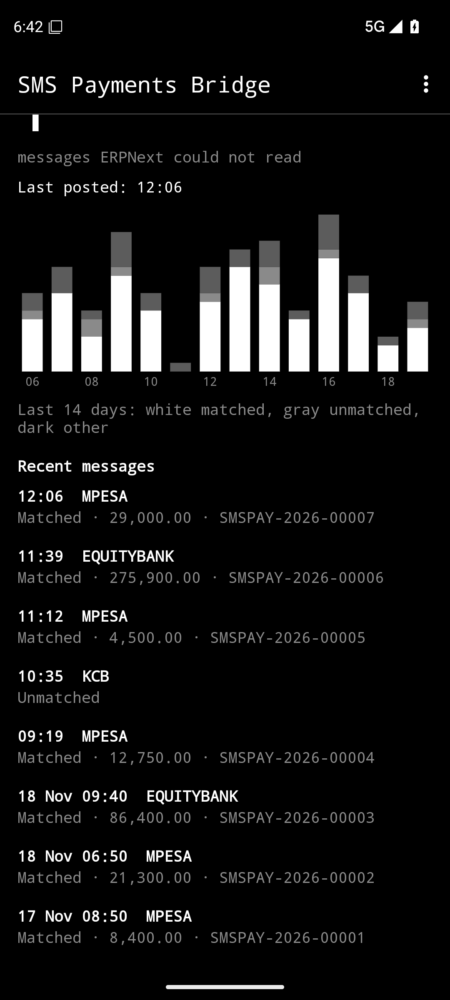
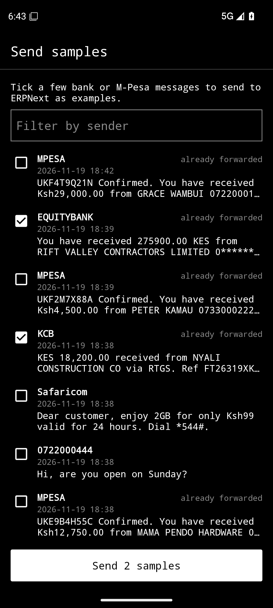

# SMS Payments Bridge

Records M-Pesa and bank payments in ERPNext from the payment SMS on a phone. This
repo holds both halves, and each needs the other:

- **Phone app** (`app/`): an Android app that forwards payment SMS (M-Pesa, bank
  alerts) to your ERPNext site.
- **ERPNext app** (`sms_payments/`): a Frappe app that receives them, matches each
  SMS to a rule and a party, and turns it into a payment.

It only forwards messages from the senders your ERPNext lists. Every other SMS
stays on the phone.

- Android 15 (API 35) or later. Package `tech.cecypo.smsbridge`.
- Kotlin, a single activity, AndroidX only. No local database, no analytics.
- The server side is the `sms_payments` Frappe app in this repo (ERPNext v16). See
  [API](#api) below. It doesn't need any bank integration app.

## Screenshots

Taken on an emulator with made-up messages, names and amounts.

| Disclosure | Setup | Checklist | Home | Send samples |
|---|---|---|---|---|
|  |  |  |  |  |

## How it works

The phone's SMS inbox is the queue. The app stores one value: the id of the last
inbox row it forwarded. A sync reads newer rows from watched senders, uploads
them in batches, and moves that id forward only after ERPNext accepts them.

A sync runs when an SMS arrives, every 15 minutes, after a reboot, and when you
open the app. If the phone was off or offline, the next sync catches up. ERPNext
ignores duplicates, so retries are safe.

## Install the ERPNext app

```bash
cd $PATH_TO_YOUR_BENCH
bench get-app https://github.com/Cecypo-Tech/sms-payments-bridge --branch main
bench --site <your-site> install-app sms_payments
```

The repo also contains the Android sources; bench ignores them.

## Install the phone app

1. Open the repo's **Actions** tab, then the latest green **build** run on
   `main`. Download the `sms-payments-bridge-<commit>` artifact and unzip it to
   get `app-release.apk`. (Or, with the GitHub CLI:
   `gh run download -R Cecypo-Tech/sms-payments-bridge`.)
2. Copy the APK to the phone and open it. Android asks to allow installs from
   that source (Files, Chrome, WhatsApp...). Allow it, then install.
3. Later builds are signed with the same key, so they install over the old app
   and keep its settings.

## Set up ERPNext first

1. In **SMS Payments Settings**, tick **Enable SMS Payments**. The watched
   senders are the senders of the enabled **SMS Rules**, plus any listed in
   **Extra Watched Senders**.
2. Create a user for the phone with only the **SMS Gateway** role. Don't give it
   any other role.
3. On that user, go to **Settings → API Access → Generate Keys**. Copy the API
   key and the secret (the secret is shown only once).

## Set up the phone

1. **Disclosure.** The first screen says what the app reads and where it sends
   it. Tap to continue.
2. **Setup.** Enter:
   - the ERPNext address (must be `https://`);
   - the API key and secret;
   - a device name (defaults to the phone model).

   **Test connection** checks the details. On success, the phone shows up in
   ERPNext as an **SMS Device**.
3. **Checklist.** Each step has a button that opens the right settings page:
   - **Allow SMS access.** Android blocks this at first for a sideloaded app.
     If the button says **Open App info**, tap ⋮ → **Allow restricted
     settings**, come back, and tap it again.
   - **Allow background activity** (turns battery optimisation off).
   - **Open autostart settings**, on phones that have it (Tecno, Infinix,
     Xiaomi, Samsung...). Turn autostart on, or set battery use to
     "No restrictions". On OnePlus, Oppo and Realme it's under App info →
     Battery usage → Allow background activity (and Allow auto launch).
4. **Home.** Shows 14 days of message counts, the unmatched count, the last
   posted entry, recent messages, and the last sync time and error. Pull down
   to sync now.

The ⋮ menu has:
- **Edit connection**: change the address, keys or name.
- **Resend recent messages**: upload the last 1–60 days again (duplicates are ignored).
- **Send samples**: pick any SMS by hand and send it to ERPNext as a sample for
  writing rules. Samples are never posted as payments automatically.

To stop a phone, untick **Enabled** on its SMS Device in ERPNext. The phone then
shows "SMS device disabled". Uninstalling the app also stops it.

## Sample rules

These rules have been tested on real SMS and matched them. Each sample below is made up but follows the same format, and each one
was checked against its pattern. Bank and M-Pesa formats change from time to
time, so test a rule against your own messages before you trust it (ERPNext's
**Add SMS manually** and the app's **Send samples** are both made for this).

In ERPNext, these go in **SMS Rule**. A Create Entry pattern needs the named
groups `amount` and `reference`; it can also use `party_name`, `date`, `time`
and `charges`. An Ignore rule only has to match. Rules are tried by priority,
highest first, so give ignore rules a higher priority than the rules they
overlap with.

### Equity - received via M-Pesa

- Sender: `Equity Bank`
- Action: **Create Entry** (Receive)
- Date format: `%d-%m-%Y`

Sample SMS (made-up values):

```text
Confirmed. KES. 12,500.00 from JANE WANJIKU MWANGI received via M-Pesa Ref. UKA1B2C3D4 on 17-11-2026 at 10:38. Thank you.
```

Pattern:

```regex
Confirmed\.\ KES\.\ (?P<amount>[\d,]+(?:\.\d{2})?)\ from\ (?P<party_name>.+?)\ received\ via\ M\-Pesa\ Ref\.\ (?P<reference>[A-Z0-9]+)\ on\ (?P<date>[\d/-]+)\ at\ (?P<time>[\d:]+(?:\s?[AP]M)?)\.\ Thank\ you\.
```

### Equity - received (bank transfer)

- Sender: `Equity Bank`
- Action: **Create Entry** (Receive)
- Date format: `%d %b %Y`

Sample SMS (made-up values):

```text
You have received 25000.00 KES from ACME HARDWARE LIMITED 0********1234 to your Equity account 0********5678. Ref. AB12CD34EF567 on 18 Nov 2026 at 11:35 EAT
```

Pattern:

```regex
You\ have\ received\ (?P<amount>[\d,]+(?:\.\d{2})?)\ KES\ from\ (?P<party_name>.+?)\ [\d,.]+\*\*\*\*\*\*\*\*[\d,.]+\ to\ your\ Equity\ account\ [\d,.]+\*\*\*\*\*\*\*\*[\d,.]+\.\ Ref\.\ (?P<reference>[A-Z0-9]+)\ on\ (?P<date>\d{1,2} [A-Za-z]+ \d{4})\ at\ (?P<time>[\d:]+(?:\s?[AP]M)?)\ EAT
```

### M-Pesa - paybill payment sent

- Sender: `MPESA`
- Action: **Create Entry** (Pay)
- Date format: `%d/%m/%y`

Sample SMS (made-up values):

```text
UKA9X8Y7Z6 Confirmed. KSH1,500.00 sent to ACME SUPPLIES for account INV-0001 on 12/11/26 at 9:30 PM New M-PESA balance is KSH20,000.00. Transaction cost, KSH0.00.Amount you can transact within the day is 499,000.00. See all your balances now https://saf.cx/AbCdE
```

Pattern:

```regex
(?P<reference>[A-Z0-9]+)\ Confirmed\.\ KSH(?P<amount>[\d,]+(?:\.\d{2})?)\ sent\ to\ (?P<party_name>.+?)\ for\ account\ \S+\ on\ (?P<date>[\d/-]+)\ at\ (?P<time>[\d:]+(?:\s?[AP]M)?)\ New\ M\-PESA\ balance\ is\ KSH[\d,.]+\.\ Transaction\ cost,\ KSH(?P<charges>[\d,]+(?:\.\d{2})?)\.Amount\ you\ can\ transact\ within\ the\ day\ is\ [\d,.]+\.\ See\ all\ your\ balances\ now\ \S+
```

### M-Pesa - reversal (ignore)

- Sender: `MPESA`
- Action: **Ignore**
- Date format: `%d/%m/%y`

Sample SMS (made-up values):

```text
UKB1C2D3E4 confirmed. Reversal of transaction UKA1B2C3D4 has been successfully reversed  on 12/11/26  at 10:00 PM and Ksh100.00 is credited to your M-PESA account. New M-PESA account balance is Ksh20,100.00.
```

Pattern:

```regex
(?P<reference>[A-Z0-9]+)\ confirmed\.\ Reversal\ of\ transaction\ \S+\ has\ been\ successfully\ reversed\ \ on\ (?P<date>[\d/-]+)\ \ at\ (?P<time>[\d:]+(?:\s?[AP]M)?)\ and\ Ksh(?P<amount>[\d,]+(?:\.\d{2})?)\ is\ credited\ to\ your\ M\-PESA\ account\.\ New\ M\-PESA\ account\ balance\ is\ Ksh[\d,.]+\.
```

### Equity - OTP (ignore)

- Sender: `Equity Bank`
- Action: **Ignore**
- Priority: 10

Sample SMS (made-up values):

```text
Dear customer, Your One Time Password (OTP) is 123456, valid for 3 minutes. Please do not share it with anyone, including us.
```

Pattern:

```regex
One Time Password \(OTP\)
```

## API

All calls go to `/api/method/sms_payments.sms_payments.api.<name>`
with `Authorization: token <key>:<secret>`. The user needs the SMS Gateway role.

| Method | Purpose |
|---|---|
| `get_config(device_id, device_name, app_version)` | Registers the device. Returns `enabled`, `watched_senders` and `backfill_days`. |
| `upload(device_id, messages, sample)` | Uploads a batch of inbox rows (`phone_sms_id`, `sender`, `body`, `received_at`). |
| `stats(device_id)` | Returns the numbers and event list shown on Home. |

## Build

CI builds every push (`.github/workflows/build.yml`): `gradle test assembleRelease`
with JDK 17 and Gradle 8.11.1, signed from the `SIGNING_KEYSTORE_B64` and
`SIGNING_PASSWORD` secrets. To build locally:

```sh
gradle test assembleDebug
```

A release build also needs `SIGNING_KEYSTORE_PATH` and `SIGNING_PASSWORD` set.
Forks must sign with their own key.

`capture.yml` (run by hand) takes screenshots on an emulator, using a
stand-in server and made-up SMS.

## Later: Google Play

For now the app is distributed as a sideloaded APK. Later, under Cecypo's Google
Play organisation account:

1. **Developer verification** (required for sideloaded apps worldwide from
   2027): register the package name and the signing certificate in the
   Android Developer Console.
2. **Optionally, a Play listing.** SMS permissions need the Permissions
   Declaration Form (claiming "Enterprise archive / enterprise device
   management"), and Google decides case by case. A listing needs:
   - a privacy policy URL;
   - a demo video of the disclosure screen and the permission flow;
   - the store listing text and screenshots (`capture.yml` makes these).

The app is already built for this: a stable package ID and signing key,
targetSdk 36, a disclosure before the permission request, and only watched
financial senders are forwarded.

## License

Copyright (C) 2026 Cecypo Tech.

Licensed under the [GNU General Public License v3.0 or later](LICENSE). You may
use, change and share it, but any version you distribute must be released
under the same license, with its source.

Under GPL section 7(b), redistributions must keep the attribution
"Based on SMS Payments Bridge by Cecypo Tech". The license does not cover the
app name or icon, so forks need their own. See [NOTICE](NOTICE).
